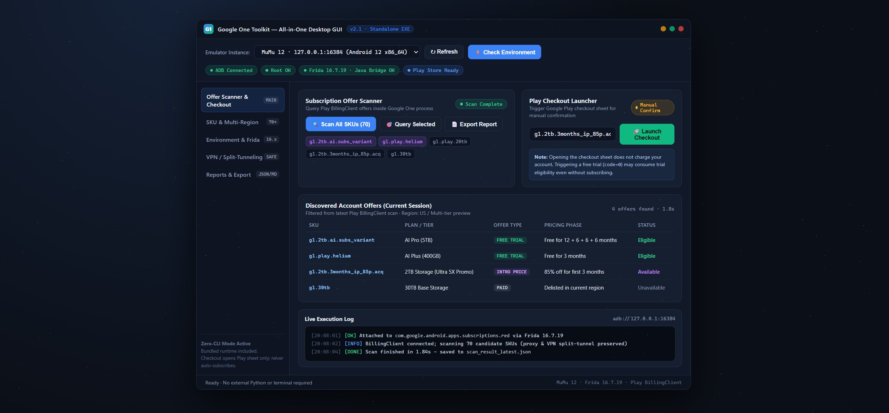

# Google One Toolkit (MuMu Emulator + Frida) — All-in-One Desktop App

**English** | [简体中文](README.zh-CN.md)

  

**`g1.30tb` has been delisted in most regions; you can start with the 3-month discounted Ultra 5X.**

A standalone Windows desktop application (`.exe`) with everything built in—**no Python installation, no pip dependencies, and no command-line setup required**.  
Powered by embedded Frida and Play BillingClient injection into Google One inside MuMu Emulator, all features are unified in a single window:
- **Scan all available subscription offers (free / paid)** for an account
- **Launch the Play checkout sheet for any SKU** (opens the checkout prompt only; never auto-subscribes)
- **Run environment diagnostics, manage multi-emulator instances, and compare multi-region pricing** with one click

---

## Key Features (All-in-One GUI)

- **Zero-Setup `.exe` Application:** Download, launch the `.exe`, and start immediately—Frida runtime and core modules are pre-packaged inside the app.
- **One-Click Environment Check:** Automatically verifies emulator connection, root access, Frida bridge status, and Google Play Store health directly in the UI.
- **Multi-Instance Selector:** Detects active emulator instances (such as `127.0.0.1:16384`) or lets you enter a custom ADB serial in the interface.
- **Full & Targeted Offer Scanner:** Scan all candidate SKUs (free trials, paid tiers, promo offers) or check specific SKUs with live progress and logs.
- **One-Click Checkout Launcher:** Select or enter any SKU and open the Google Play checkout sheet directly on the emulator screen, then confirm manually.
- **Multi-Region Price Comparison & Reports:** View scan results, compare pricing across regions, and export reports directly from the app.

---

## Quick Start

[View all releases](../../releases)

| Platform | Download | Run |
|----------|----------|-----|
| **Windows x64** | [GoogleOneToolkit-x64.7z](../../releases) | Run installer → launch `GoogleOneToolkit-x64.7z` |
| **Linux x64** | [GoogleOneToolkit-Linux-x64.run](../../releases) | `chmod +x` → run installer |

---

## SKU Reference Table

| Tier | SKU | Notes |
|---|---|---|
| 30 GB / 100GB / 200GB | `g1.30gb` / `g1.100gb` / `g1.200gb` | Base storage |
| 2TB / 5TB / 10TB / 20TB / 30TB | `g1.2tb` / `g1.5tb` / `g1.10tb` / `g1.20tb` / `g1.30tb` | Base storage |
| Annual plan | Any of the above + `.annual` (e.g., `g1.2tb.annual`) | Some tiers have no annual plan |
| AI Plus (400GB) | `g1.play.helium` | Often has 12/6/3/1-month free trials |
| AI Pro (5TB) | `g1.2tb.ai.subs_variant` | Often has 12+6+6+6-month free trials |
| Ultra 20TB | `g1.play.20tb` | Trial depends on account eligibility |
| Ultra AI Pro (30TB) | `g1.play.ai.pro` / `g1.30tb` | Most accounts have no trial |
| 2TB first 3 months discount | `g1.2tb.3months_ip_85p.acq` | Intro price (`introprice`), not free |

> Free trial tiers are generally only attached to SKUs **with the `play` prefix** or **`subs_variant`**; SKUs with the `.eft` suffix are trial-specific SKUs. Rely on the actual scan results returned in the app.

---

## Multiple Emulator Instances

- When running multiple emulator instances simultaneously, pick the target device in the app's **Instance / Serial selector** (`127.0.0.1:16384` is MuMu 12's default ADB port; additional instances use different ports).
- Connections match by serial precisely and will not cross-connect between instances.

---

## VPN Coexistence

- The app **does not clear device proxy settings or kill VPN clients** (such as Clash or v2rayNG).
- Injection runs over the local ADB channel (`127.0.0.1:xxxxx`) without interfering with VPN traffic inside the emulator.
- For best reliability, set your VPN to **split-tunneling / per-app mode** and exclude:
  `com.android.vending`, `com.google.android.gms`, `com.google.android.apps.subscriptions.red`  
  (Or in TUN mode, switch DNS from `fake-ip` to `redir-host` so Play billing connects properly.)

---

## Troubleshooting (Sorted by Frequency)

| Symptom | Cause | Fix |
|---|---|---|
| Checkout sheet does not pop up, Play Store looks "dead" (billing service crash / gRPC timeout) | **VPN (such as Surfshark) hijacked Play's network**, causing the billing service to crash and restart | ① Open VPN settings → Split tunneling / Per-app proxy → Exclude `Google Play Store`, `Google Play services`, and `Google One`; ② Or disconnect VPN before launching checkout |
| No `launched` event received | Play Store was not running or failed to start in time | Click **Check Environment** in the app to verify Play Store (`vending`) status |
| Play Store repeatedly freezes / fails to attach | Play Store hung after launching checkout multiple times in a row | **Reboot the emulator** and try again |
| Play Store crashes the moment the checkout sheet pops up | Bug in an older Play Store version on the MuMu image | Update Google Play Store inside the emulator, or clear its app data |
| Java bridge / Frida mismatch error on device | Stale or mismatched `frida-server` left on the emulator from an older setup | Delete `/data/local/tmp/frida-server` on the device and re-run **Check Environment** so the app deploys the matching bundled version |
| Reports "no root" right after rebooting the emulator | `adbd` briefly drops immediately after enabling root | Root retry is handled automatically; make sure **Root** is toggled on in MuMu emulator settings |
| Empty offers returned on query | Play Store / Frida bridge issue or SKU is not listed in that account's region | Click **Check Environment** first, then verify whether the SKU is available in that region |

---

## Important Notes

- Triggering `launchBillingFlow` (`code=0`) **may consume the account's trial eligibility**, even if you do not click subscribe—do not repeatedly trigger free trials on the same account.
- Opening the checkout sheet without clicking subscribe does not charge you; clicking subscribe charges the price displayed on screen.
- Free trials auto-renew when they end—remember to cancel in advance.
