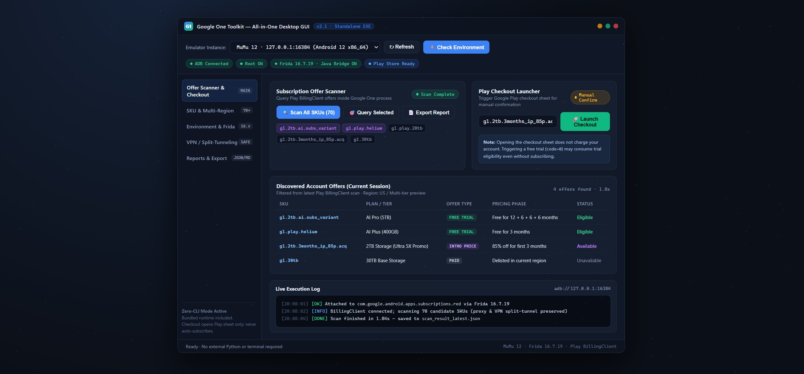

# Google One 工具包（MuMu 模拟器 + Frida）— 一体化桌面应用程序

[English](README.md) | **简体中文**

  

**`g1.30tb` 已在大部分区域下架，可以先搞搞 3 个月打折的 Ultra 5X。**

一款内置全部组件的独立 Windows 桌面应用程序（`.exe`）——**无需安装 Python、无需配置 pip 依赖，也无需命令行设置**。  
基于内置 Frida 并将其注入 MuMu 模拟器中的 Google One 进程以调用 Play BillingClient，所有功能均整合在一个窗口中：
- **扫描账号可用的全部订阅 offer（免费 / 付费）**
- **拉起任意 SKU 的 Play 收银台**（仅弹出收银台提示框，绝不自动订阅）
- **一键运行环境诊断、管理多模拟器实例以及对比多地区价格**

---

## 核心功能（一体化 GUI）

- **零配置 `.exe` 应用程序：** 下载并启动 `.exe` 即可立即开始使用——Frida 运行时与核心模块均已预打包在应用内部。
- **一键环境检测：** 直接在界面中自动验证模拟器连接状态、root 权限、Frida 桥接状态以及 Google Play 商店运行状态。
- **多实例选择器：** 自动检测正在运行的模拟器实例（如 `127.0.0.1:16384`），或允许在界面中手动输入自定义 ADB 序列号（serial）。
- **全量与定向 Offer 扫描器：** 扫描所有候选 SKU（免费试用、付费档位、促销优惠）或查询指定 SKU，并在界面中实时显示进度与日志。
- **一键拉起收银台：** 选择或输入任意 SKU，直接在模拟器屏幕上打开 Google Play 收银台，随后由人工在屏幕上确认。
- **多地区价格对比与报告：** 直接在应用内查看扫描结果、对比不同地区的价格并导出报告。

---

## 快速上手

[查看所有发布版本](../../releases)

| 平台 | 下载 | 运行 |
|----------|----------|-----|
| **Windows x64** | [GoogleOneToolkit-x64.7z](../../releases) | 运行安装程序 → 启动 `GoogleOneToolkit-x64.7z` |
| **Linux x64** | [GoogleOneToolkit-Linux-x64.run](../../releases) | `chmod +x` → 运行安装程序 |

---

## SKU 对照表

| 档位 | SKU | 说明 |
|---|---|---|
| 30 GB / 100GB / 200GB | `g1.30gb` / `g1.100gb` / `g1.200gb` | 基础存储 |
| 2TB / 5TB / 10TB / 20TB / 30TB | `g1.2tb` / `g1.5tb` / `g1.10tb` / `g1.20tb` / `g1.30tb` | 基础存储 |
| 年付版 | 上面任一 + `.annual`（如 `g1.2tb.annual`） | 部分档无年付 |
| AI Plus (400GB) | `g1.play.helium` | 常有 12/6/3/1 个月免费试用 |
| AI Pro (5TB) | `g1.2tb.ai.subs_variant` | 常有 12+6+6+6 个月免费试用 |
| Ultra 20TB | `g1.play.20tb` | 试用看账号资格 |
| Ultra AI Pro (30TB) | `g1.play.ai.pro` / `g1.30tb` | 多数号无试用 |
| 2TB 首三月折扣 | `g1.2tb.3months_ip_85p.acq` | 首发优惠价（`introprice`），非免费 |

> 免费试用档基本只挂在**带 `play` 前缀**或 **`subs_variant`** 的 SKU 上；带 `.eft` 后缀的是试用专用 SKU。请以应用内实际扫描返回的结果为准。

---

## 多模拟器实例

- 同时运行多个模拟器实例时，请在应用的**实例 / 序列号选择器（Instance / Serial selector）**中选择目标设备（`127.0.0.1:16384` 为 MuMu 12 的默认 ADB 端口；多开实例会使用其他端口）。
- 连接会按序列号（serial）精确匹配，不会在实例之间串台。

---

## VPN 共存

- 本应用**不会清除设备代理设置，也不会关闭 VPN 客户端**（如 Clash 或 v2rayNG）。
- 注入通过本地 ADB 通道（`127.0.0.1:xxxxx`）进行，不会干扰模拟器内部的 VPN 流量。
- 为获得最佳稳定性，请将 VPN 设置为**分应用代理 / 隧道分离（split-tunneling / per-app）模式**，并排除以下三个包名：
  `com.android.vending`、`com.google.android.gms`、`com.google.android.apps.subscriptions.red`  
  （或者在 TUN 模式下，将 DNS 从 `fake-ip` 切换为 `redir-host`，以便 Play 结算正常连接。）

---

## 故障排查（按命中频率排序）

| 症状 | 原因 | 解法 |
|---|---|---|
| 收银台不弹出，Play 商店像是「死了」（结算服务崩溃 / gRPC 超时） | **VPN（如 Surfshark）劫持了 Play 的网络**，导致结算服务崩溃并重启 | ① 打开 VPN 设置 → 分应用代理 / 隧道分离（Split tunneling / Per-app proxy）→ 排除 `Google Play 商店`、`Google Play 服务` 和 `Google One`；② 或在拉起收银台前先断开 VPN |
| 未收到 `launched` 事件 | Play 商店未运行或未能及时启动 | 在应用中点击**检测环境（Check Environment）**以验证 Play 商店（`vending`）状态 |
| Play 商店反复假死 / 附加失败（failed to attach） | 连续多次拉起收银台后 Play 商店卡死 | **重启模拟器**后再试 |
| 收银台弹出瞬间 Play 商店崩溃 | MuMu 镜像上旧版本 Play 商店的 Bug | 在模拟器内升级 Google Play 商店，或清除其应用数据 |
| 设备上出现 Java 桥 / Frida 版本不匹配错误 | 模拟器中残留了旧配置留下的过期或不匹配的 `frida-server` | 删除设备上的 `/data/local/tmp/frida-server`，然后重新运行**检测环境（Check Environment）**，让应用自动部署内置的匹配版本 |
| 重启模拟器后立即提示「没有 root（no root）」 | 启用 root 后 `adbd` 会短暂断开连接 | 系统会自动处理 root 重试；请确保在 MuMu 模拟器设置中已开启 **Root** 权限 |
| 查询返回空 offer | Play 商店 / Frida 桥接异常，或该 SKU 未在该账号所在地区上架 | 先点击**检测环境（Check Environment）**，再确认该 SKU 是否在该地区可用 |

---

## 重要注意

- 触发 `launchBillingFlow`（返回 `code=0`）**即可能消耗该账号的试用资格**，即使你最后没有点击订阅——请勿对同一个账号反复触发免费试用。
- 仅打开收银台而不点击订阅不会扣费；点击订阅则会按屏幕上显示的价格扣费。
- 免费试用结束时会自动续费——记得提前取消。
